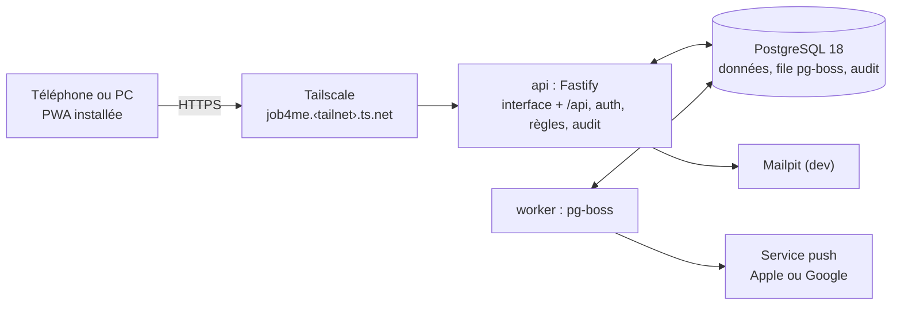

# Phase 0 : fondations, plan détaillé

Plan validé par Mehdi le 20/11/2026, avec les décisions de la section 13. Il applique `CLAUDE.md`, `docs/SPEC.md` (sections 9 à 11, 13 et 14) et, pour ce qui concerne déjà la phase 0, `docs/SOURCES.md`. Les écarts à la spécification sont regroupés en section 12 : ceux de la phase 0 sont tranchés, les autres le seront à leur phase.

## 1. Résumé

- **Monorepo** pnpm + Turborepo : trois applications (`web`, `api`, `worker`) et des paquets partagés (`contracts`, `db`, `config`, `security`, `logger`, `ui`, `i18n`).
- **Une seule origine HTTPS** : l'API Fastify sert l'interface (application Vite + React) et les routes `/api` ; seuls l'API et le worker touchent la base et les secrets.
- **Accès depuis le téléphone par Tailscale** : une adresse `*.ts.net` réservée à tes appareils, rien d'exposé sur Internet.
- **Docker Compose** : PostgreSQL 18 et Mailpit pour le développement ; un profil `app` fait tourner toute la pile en conteneurs (machine Linux du domicile, tests de bout en bout en CI).
- **Base** : dix tables pour l'authentification, le journal d'audit et les notifications, et des conventions valables pour toutes les tables suivantes (`user_id`, UUIDv7, isolation par utilisateur).
- **Authentification** : compte créé en ligne de commande, lien d'enrôlement à usage unique, passkey avec vérification de l'utilisateur, TOTP et dix codes de secours ; secours par mot de passe Argon2id + TOTP ; sessions côté serveur ; ré-authentification pour les actions sensibles.
- **CI GitHub Actions** : détection de secrets, lint, types, tests unitaires et d'intégration sur un vrai PostgreSQL, tests de bout en bout Playwright avec un authentificateur WebAuthn virtuel, Semgrep, audit des dépendances, SBOM. Une branche et une pull request par lot ; pendant la phase 0, Claude la fusionne lui-même après une CI verte.
- **Fin de phase** : une commande démarre tout, la connexion par passkey marche sur PC et sur iPhone (PWA installée), la CI est verte.

## 2. Périmètre et critères de fin

**Inclus** (spécification, section 14) : monorepo, Docker Compose, CI, design system sobre, traduction française, compte unique créé en ligne de commande, passkey et TOTP, journal d'audit.
**Ajouté** : une PWA minimale (manifeste, service worker, notification de test), parce que la section 13 demande de vérifier l'installation et les notifications sur un vrai iPhone dès la phase 0.
**Exclu** : profil, collecte, IA, Gmail, quotas. Aucune table pour ces sujets avant leur phase.

**Critères de fin, tous vérifiables**

1. Sur un clone neuf (prérequis : Docker, Node 26 et pnpm), `pnpm install` puis `pnpm dev` démarrent PostgreSQL, Mailpit, les migrations, l'API, le worker et l'interface ; `pnpm stack:up` démarre la pile complète en conteneurs.
2. `pnpm job4me user:create` crée le compte et affiche un lien d'enrôlement valable 15 minutes.
3. Enrôlement complet (passkey, TOTP, codes de secours), puis connexion par passkey sur PC ; secours par mot de passe + TOTP ; un code de secours est refusé à sa seconde utilisation.
4. Chaque événement d'authentification figure dans le journal d'audit, consultable dans Paramètres > Sécurité.
5. Sur iPhone, par Tailscale : installation sur l'écran d'accueil, connexion par Face ID, notification de test reçue.
6. CI verte sur `main`, tests de sécurité de la section 8 compris.
7. Documents : modèle de menaces (`docs/security/threat-model.md`), ADR de la section 14, revue de sécurité de la phase.

## 3. Structure du monorepo

```text
job4me/
├── apps/
│   ├── web/          interface Vite + React : écrans, PWA, service worker
│   ├── api/          Fastify + Zod : routes /api/*, service de l'interface, contrat OpenAPI, CLI d'administration
│   └── worker/       pg-boss : tâches de fond (phase 0 : purges, notification de test)
├── packages/
│   ├── contracts/    schémas Zod partagés entre web et api (seul paquet commun aux deux)
│   ├── db/           schéma Drizzle, migrations SQL relues et versionnées, rôles, données fictives
│   ├── config/       lecture et validation de config/*.yaml et des variables d'environnement
│   ├── security/     chiffrement AES-256-GCM, dérivation des clés, jetons, hachage
│   ├── logger/       pino avec masquage (cookies, jetons, mots de passe, api_key et app_key dans les URL)
│   ├── ui/           design system : jetons Tailwind, composants shadcn/ui adaptés
│   ├── i18n/         messages fr (par défaut), nl et en, formats belges
│   └── tooling/      tsconfig, ESLint, Prettier et Vitest communs
├── config/default.yaml   seuils, durées, plafonds, quotas et prix : jamais dans le code
├── infra/            compose.yaml, Dockerfiles, initialisation des rôles PostgreSQL
├── docs/             SPEC.md, SOURCES.md, adr/, plans/, security/
├── .github/workflows/
└── CLAUDE.md
```

- Viendront à leur phase, pas avant : `collectors` (phase 2), `pipeline` et `scoring` (phase 3), `documents` (phase 4), `mail` et `rules` (phase 5), `billing` (phase 6).
- `apps/web` ne peut importer ni `db`, ni `security`, ni un SDK de service externe (règle ESLint `no-restricted-imports`, vérifiée en CI) : un secret ne peut pas finir dans le code envoyé au navigateur.
- Interface : React, un routeur typé (TanStack Router) et TanStack Query pour les appels à l'API ; Tailwind 4 et shadcn/ui.
- Node 26 LTS, TypeScript 6.0 en mode strict (la 7.0 n'est pas encore prise en charge par typescript-eslint), ESM partout, versions épinglées (`packageManager`, `.node-version`).
- Scripts d'outillage écrits en TypeScript, pas en bash.
- La CLI d'administration vit dans `apps/api` et s'appelle par `pnpm job4me <commande>` : `user:create`, `user:enroll-link`, `sessions:revoke-all`, `audit:tail`, `config:check`, `mail:test`.
- Configuration : `config/default.yaml`, surchargé par un fichier local hors Git, validé par un schéma Zod au démarrage. L'application refuse de démarrer si une valeur manque ou sort de ses bornes.

## 4. Architecture d'exécution



- **Une seule origine** : Fastify sert les fichiers construits par Vite et les routes `/api/*`. En développement, le serveur Vite relaie `/api` vers Fastify. Pas de CORS, cookies `SameSite=Strict`, CSP `connect-src 'self'`.
- **L'interface tourne entièrement dans le navigateur** : aucun secret, aucun accès à la base. Toutes les données passent par l'API, qui valide, autorise et journalise.
- **CSP statique** : `script-src 'self'` sans aucun script en ligne, `object-src 'none'`, `base-uri 'none'`, `frame-ancestors 'none'`.
- **Rien n'écoute sur le réseau local** : les ports publiés par Docker sont liés à `127.0.0.1`. Un port publié sur toutes les interfaces serait joignable depuis le réseau local, et sous Linux il contourne même le pare-feu de l'hôte. Tailscale, installé sur la machine, relie tes appareils à `127.0.0.1:3000` par `tailscale serve` (jamais par Funnel, qui publierait l'application sur Internet).

## 5. Services Docker Compose

| Service | Image | Rôle | Exposition | Profil |
| --- | --- | --- | --- | --- |
| `postgres` | `postgres:18`, épinglée par empreinte | base unique et file de tâches | `127.0.0.1:5432` en dev, aucune sinon | toujours |
| `mailpit` | `axllent/mailpit`, épinglée | capture de tous les mails de dev | interface sur `127.0.0.1:8025` | dev |
| `migrate` | image de l'API | applique les migrations puis s'arrête | aucune | `app` |
| `api` | image construite (API et interface statique) | API Fastify et interface | `127.0.0.1:3000` | `app` |
| `worker` | image construite | tâches pg-boss | aucune | `app` |

- **`pnpm dev`** démarre `postgres` et `mailpit` (attente des sondes de santé), applique les migrations, puis lance l'API, le worker et le serveur Vite en mode surveillance sur l'hôte. **`pnpm stack:up`** met tout en conteneurs, pour la machine du domicile et les tests de bout en bout.
- **Tailscale** s'installe sur la machine Linux elle-même, hors Compose : `tailscale serve` sert `127.0.0.1:3000` en HTTPS sur l'adresse `job4me.‹tailnet›.ts.net`.
- **Deux rôles PostgreSQL** : `job4me_owner` possède les tables et passe les migrations ; `job4me_app`, utilisé à l'exécution, lit et écrit les données sans pouvoir modifier le schéma, et n'a que `INSERT` et `SELECT` sur `audit_log`.
- **Secrets** : `pnpm setup:dev` (ou `setup:home` sur la machine de la maison) génère des clés aléatoires en fichiers dans `secrets/`, jamais commités, et un `.env` qui ne contient que des réglages et des chemins ; les variables `*_FILE` les lisent, et en profil `app` ce sont des secrets Compose montés en fichiers, invisibles dans `docker inspect` (modifié le 21/11/2026 : fichiers dès le développement).
- **Durcissement** : utilisateur non root, système de fichiers en lecture seule quand c'est possible, `no-new-privileges`, aucune capacité Linux superflue, sondes `/api/health` (processus vivant) et `/api/ready` (base joignable, migrations à jour).
- **Mails** : en développement, toute configuration SMTP autre que Mailpit est refusée au démarrage ; `pnpm job4me mail:test` vérifie le chemin.
- **Volumes** : `pgdata` (monté sur `/var/lib/postgresql`, l'image 18 ayant déplacé ses données) et `files`, vide en phase 0. Le chiffrement du volume vient du chiffrement du disque de la machine Linux (LUKS), un prérequis (décision D4).
- Ni Redis, ni stockage S3, ni proxy inverse en phase 0.

## 6. Schéma initial de la base

**Conventions pour toutes les tables, présentes et futures**

- Identifiants `uuid` générés par `uuidv7()`, natif dans PostgreSQL 18 : ordonnés dans le temps, impossibles à deviner.
- Dates en `timestamptz` : UTC en base, affichage à l'heure de Bruxelles.
- Toute table propre à un utilisateur porte `user_id` (clé étrangère, suppression en cascade, index). Toute fonction d'accès aux données exige l'identifiant de l'utilisateur connecté, et aucune route ne lit une ressource par son seul identifiant.
- À partir de la phase 1, deuxième barrière : Row Level Security sur les tables métier, avec `app.user_id` fixé à chaque transaction. Les tables d'authentification en restent hors, car elles servent avant de connaître l'utilisateur ; seul le module d'authentification y accède.
- Champs sensibles chiffrés par l'application : AES-256-GCM, nonce aléatoire, données associées `table:colonne:id` (un chiffré ne peut pas être recopié sur une autre ligne), colonne `key_version` pour la rotation des clés.
- Migrations générées par drizzle-kit en SQL, relues et versionnées ; jamais de `push` sur une base réelle. pg-boss gère son propre schéma `pgboss`.

**Tables de la phase 0**

| Table | Colonnes principales | Remarques |
| --- | --- | --- |
| `user` | `id`, `email` (citext, unique), `display_name`, `role` (`owner`), `locale` (`fr-BE`), `time_zone` (`Europe/Brussels`), `webauthn_user_handle`, `password_hash`, `password_fallback_enabled`, `status`, dates | prêt pour d'autres comptes ; l'identifiant WebAuthn (32 octets aléatoires) ne révèle ni l'e-mail ni l'id |
| `passkey` | `id`, `user_id`, `credential_id` (unique), `public_key`, `sign_count`, `transports`, `aaguid`, `backed_up`, `name`, `created_at`, `last_used_at` | `backed_up` signale une passkey synchronisée (iCloud, Google) |
| `session` | `id`, `user_id`, `token_hash` (unique), `auth_method`, `created_at`, `last_seen_at`, `idle_expires_at`, `absolute_expires_at`, `reauthenticated_at`, `user_agent_label`, `revoked_at` | seul le haché SHA-256 du jeton est stocké |
| `auth_challenge` | `id`, `purpose` (`registration`, `authentication`, `reauth`), `challenge`, `user_id`, `expires_at`, `consumed_at` | défis WebAuthn à usage unique, valables 5 minutes |
| `one_time_token` | `id`, `user_id`, `purpose` (`enrollment`), `token_hash`, `expires_at`, `consumed_at` | liens d'enrôlement émis par la CLI |
| `totp_secret` | `user_id`, `secret_ciphertext`, `key_version`, `confirmed_at`, `last_used_step` | `last_used_step` empêche de rejouer un code |
| `recovery_code` | `id`, `user_id`, `batch_id`, `code_hmac`, `used_at`, `created_at` | 10 codes de 16 caractères, HMAC avec une clé serveur |
| `auth_throttle` | `user_id`, `factor` (`password`, `totp`, `recovery`), `failures`, `locked_until`, `last_failure_at` | verrouillage progressif, facteur par facteur |
| `push_subscription` | `id`, `user_id`, `endpoint` (unique), `p256dh`, `auth`, `user_agent_label`, `created_at`, `last_success_at` | notifications push, testées dès la phase 0 |
| `audit_log` | `id` (bigint), `occurred_at`, `actor_type` (`user`, `cli`, `system`), `actor_user_id`, `action`, `outcome`, `target_type`, `target_id`, `request_id`, `metadata` (jsonb) | ajout seul : droits du rôle applicatif et déclencheur qui refuse `UPDATE` et `DELETE` ; `actor_user_id` sans clé étrangère, pour survivre à la suppression d'un compte ; `metadata` sans donnée personnelle ni secret |

Les autres entités de la section 10 de la spécification (`profile`, `source`, `job_offer`, `consent`…) arrivent avec leur phase.

**Événements journalisés en phase 0** : `user.created`, `enrollment.link_issued`, `passkey.registered`, `passkey.renamed`, `passkey.removed`, `auth.login.succeeded` et `auth.login.failed` (avec la méthode), `auth.locked`, `auth.reauth`, `totp.enabled`, `totp.reset`, `recovery_codes.generated`, `recovery_code.used`, `password.changed`, `session.revoked`, `sessions.revoked_all`, `push.test_sent`.

## 7. Authentification par passkey et TOTP

### 7.1 Création du compte, sans inscription publique

1. Sur la machine, `pnpm job4me user:create --email … --name …` crée le compte (rôle `owner`) et demande un mot de passe en saisie masquée : 12 caractères au moins, mots de passe courants refusés.
2. La commande affiche un lien d'enrôlement à usage unique, valable 15 minutes (jeton de 256 bits dont seul le haché est stocké).
3. Le lien ouvre l'enrôlement : première passkey, puis TOTP (QR code produit par le serveur, jamais par un service tiers ; activation confirmée par un code valide), puis dix codes de secours à ranger, avec confirmation explicite.
4. `pnpm job4me user:enroll-link` émet un nouveau lien si tous les moyens de connexion sont perdus : l'accès au terminal de la machine reste la racine de confiance. Chaque étape est journalisée.

### 7.2 Connexion par passkey, la voie normale

- Passkeys découvrables (`residentKey: required`) et vérification de l'utilisateur exigée (`userVerification: required`) : avec Face ID, l'empreinte ou le code de l'appareil, un seul geste vaut double authentification et résiste à l'hameçonnage.
- Remplissage automatique (médiation conditionnelle) et bouton « Se connecter avec une passkey ».
- Contrôles serveur avec SimpleWebAuthn : défi à usage unique de 5 minutes, origine exacte et RP ID tirés de la configuration (`localhost` en développement, `job4me.‹tailnet›.ts.net` sur la machine du domicile), drapeau de vérification de l'utilisateur, compteur de signature quand il n'est pas nul (les passkeys synchronisées renvoient 0).
- Je recommande deux passkeys dès l'enrôlement : l'iPhone (trousseau iCloud) et le PC, ou une clé matérielle.

### 7.3 Secours : mot de passe + TOTP

- E-mail et mot de passe, puis code TOTP (RFC 6238 : 6 chiffres, 30 secondes, tolérance d'un pas, refus d'un code déjà utilisé) ou, à défaut, un code de secours à usage unique.
- Le mot de passe ne suffit jamais seul ; un seul message d'erreur, sans indice.
- Argon2id avec 64 Mio, 3 passes et 4 voies (deuxième jeu recommandé par la RFC 9106). Paramètres dans la configuration, nouveau hachage à la connexion s'ils changent.
- Option « désactiver le secours par mot de passe », proposée dès que deux passkeys existent : un faux site peut relayer le couple mot de passe + TOTP, pas une passkey.

### 7.4 Sessions et requêtes

- Jeton aléatoire de 256 bits dans le cookie `__Host-j4m_session` (`HttpOnly`, `Secure`, `SameSite=Strict`, `Path=/`). La base ne stocke que son haché : une copie de la base ne donne aucune session utilisable.
- Durées, dans la configuration : 12 heures d'inactivité, 7 jours au plus. Nouveau jeton à chaque connexion et à chaque ré-authentification ; liste des sessions actives, révocation unitaire ou globale.
- CSRF, avec les trois couches demandées par la spécification : `SameSite=Strict`, contrôle de l'en-tête `Origin` sur toute requête qui modifie, et jeton CSRF dérivé de la session (HMAC) envoyé dans un en-tête.
- **Ré-authentification** datant de moins de 5 minutes, par passkey ou par mot de passe + TOTP, pour ajouter ou retirer une passkey, changer le mot de passe, réinitialiser le TOTP ou les codes de secours, révoquer toutes les sessions ; puis, aux phases suivantes, pour les actions de la section 11 de la spécification (envoi automatique, règles, boîte mail, export et suppression).
- **Verrouillage progressif par facteur** : après 5 échecs consécutifs, une minute d'attente, doublée à chaque nouvel échec jusqu'à une heure ; jamais définitif, pour ne pas t'enfermer dehors. Un attaquant qui martèle le formulaire de mot de passe ne bloque pas ta passkey. S'y ajoute une limite de débit globale sur `/api/auth/*`.
- Briques retenues : `@simplewebauthn/server` et `@simplewebauthn/browser`, `otpauth`, `@node-rs/argon2`, `qrcode` côté serveur, zxcvbn-ts pour la solidité du mot de passe. Pas de cadriciel d'authentification complet (Better Auth, Auth.js) : nos parcours (CLI, enrôlement, ré-authentification, audit) sont plus simples à maîtriser avec des briques éprouvées.

**Deux effets de bord connus, prévus dès maintenant**

- Une passkey est liée à son nom de domaine : celles créées sur `localhost` ne serviront pas sur l'adresse Tailscale. Il faut donc nommer la machine `job4me` et fixer le nom du réseau Tailscale avant d'enregistrer les passkeys définitives.
- Avec `SameSite=Strict`, la première page ouverte depuis un lien externe (un mail, le retour de l'autorisation Google en phase 5) arrive sans cookie : une page relais rechargera dans le bon contexte.

### 7.5 Chiffrement et clés

- Une clé maîtresse de 32 octets, dans un fichier hors du dépôt sur la machine du domicile ; en développement, `pnpm setup:dev` en génère une jetable.
- Une clé dérivée par usage (HKDF-SHA-256) : TOTP, codes de secours, CSRF, puis jetons Gmail (phase 5) et fichiers.
- Perdre la clé maîtresse rend le TOTP et, plus tard, les jetons Gmail illisibles : sa copie de secours va dans ton gestionnaire de mots de passe, avec les codes de secours (décision D5).

## 8. Modèle de menaces de la phase 0

**Actifs** : le compte (sessions, passkeys, secret TOTP, codes de secours, haché du mot de passe), la clé maîtresse, le journal d'audit, le code et sa chaîne de construction. Les données du CV, l'accès Gmail et les clés d'API arriveront plus tard, sur ces fondations.

**Frontières de confiance** : téléphone ou PC, Tailscale, `api`, PostgreSQL ; le terminal de la machine (confiance totale) ; GitHub (code et CI) ; les environnements de développement, dont celui de Claude Code dans le cloud, qui ne reçoivent jamais de secret ni de donnée réelle.

| # | Menace | Scénario | Contrôles | Test automatisé |
| --- | --- | --- | --- | --- |
| 1 | Prise de compte | mot de passe deviné ou réutilisé | passkey en priorité, mot de passe jamais seul, Argon2id, verrouillage progressif, limite de débit | après 5 échecs : verrouillé, la passkey passe toujours |
| 2 | Prise de compte | hameçonnage relayé en temps réel | passkey liée à l'origine, secours désactivable, accès réservé aux appareils Tailscale | réponse WebAuthn d'une autre origine refusée |
| 3 | Prise de compte | rejeu d'un code TOTP ou de secours | dernier pas TOTP mémorisé, codes à usage unique | même code deux fois : refusé |
| 4 | Vol de session | cookie volé, session fixée | `HttpOnly`, `Secure`, `SameSite=Strict`, préfixe `__Host-`, rotation, jeton haché, expirations | drapeaux vérifiés ; ancien jeton invalide après connexion |
| 5 | CSRF | formulaire piégé sur un autre site | `SameSite`, contrôle d'`Origin`, jeton | sans `Origin`, autre origine ou sans jeton : 403 |
| 6 | XSS | script injecté dans une page | échappement React, CSP stricte sans script en ligne, `dangerouslySetInnerHTML` interdit par ESLint | CSP présente sur chaque réponse, sans `unsafe-inline` |
| 7 | Accès à un autre compte | identifiant modifié dans une requête | `user_id` exigé partout, UUIDv7, RLS dès la phase 1 | deux comptes de test : A ne voit ni ne supprime les passkeys ou sessions de B |
| 8 | Fuite de secrets | clé commitée ou écrite dans un journal | `.env` hors Git, gitleaks en hook et en CI, masquage pino, secrets en fichiers | test de masquage ; gitleaks sur tout l'historique |
| 9 | Copie de la base | sauvegarde volée | jetons hachés, TOTP chiffré, codes en HMAC, clé hors base, disque chiffré | lecture brute des tables : aucun secret en clair |
| 10 | Effacement de traces | journal modifié | `audit_log` en ajout seul (droits et déclencheur) | `UPDATE` ou `DELETE` par le rôle applicatif : erreur |
| 11 | Saturation | rafale sur `/api/auth`, corps énorme | limites de débit, taille de corps maximale, délais | au-delà de la limite : 429 |
| 12 | Dépendance compromise | paquet npm malveillant | lockfile figé, scripts d'installation bloqués sauf liste blanche, délai avant d'adopter une version fraîchement publiée, Renovate, audit, SBOM | jobs d'audit et SBOM en CI |
| 13 | CI détournée | workflow abusé pour exfiltrer | permissions minimales, actions épinglées par SHA, pas de `pull_request_target`, aucun secret en CI en phase 0 | analyse des workflows par zizmor |
| 14 | Exposition réseau | port ouvert sur la box | ports liés à `127.0.0.1`, aucun port ouvert sur la box, accès par Tailscale seulement | contrôle des ports publiés |
| 15 | Fuite par les erreurs | pile d'appels renvoyée au client | gestionnaire d'erreurs générique, identifiant de requête | une erreur 500 ne contient aucun détail interne |

Ce modèle sera repris dans `docs/security/threat-model.md` et complété avant chaque fonction de collecte, d'IA, de mail ou de paiement, comme le veut `CLAUDE.md`.

## 9. Pipeline CI

**`ci.yml`, à chaque push et à chaque pull request**

| Job | Contenu |
| --- | --- |
| `secrets` | gitleaks sur tout l'historique |
| `lint` | installation figée, Prettier, ESLint (dont les règles d'imports et l'interdiction des textes d'interface non traduits), vérification des types |
| `unit` | Vitest : chiffrement, TOTP, masquage des journaux, validation de la configuration |
| `integration` | PostgreSQL 18 en service, migrations, tests de l'API : authentification, CSRF, accès croisés, verrouillage, audit en ajout seul |
| `e2e` | pile en conteneurs, Playwright avec authentificateur WebAuthn virtuel (enrôlement, connexion par passkey, secours TOTP), axe-core pour l'accessibilité des écrans |
| `security` | Semgrep (règles TypeScript, Node et OWASP), audit des dépendances, zizmor sur les workflows, SBOM CycloneDX en artefact |

- Tous les jobs doivent passer. `permissions: contents: read` par défaut, actions épinglées par SHA, annulation des exécutions dépassées, cache du store pnpm.
- Une analyse planifiée chaque semaine : vulnérabilités de l'image Docker et des dépendances, avec osv-scanner (modifié le 22/11/2026 : Trivy, compromis en mars 2026, est écarté ; voir la revue de sécurité).
- Renovate : mises à jour groupées chaque semaine, versions publiées depuis au moins 7 jours, fusion automatique des seuls correctifs d'outils de développement, CI verte exigée (modifié le 22/11/2026 : 7 jours au lieu de 3, sur alerte de Semgrep).
- En local, un hook pre-commit lance gitleaks sur les fichiers indexés et le formatage. Messages de commit en anglais.
- Budget : un dépôt privé gratuit dispose de 2 000 minutes d'Actions par mois ; objectif, moins de 8 minutes par exécution.
- **Dépôt privé sur un compte gratuit (décision D1)** : pas de protection de branche ni de règles, pas de CodeQL ni de blocage des secrets à l'envoi. Semgrep et gitleaks couvrent l'analyse et les secrets. Le travail arrive par pull request, une par lot (décision D6) ; pendant la phase 0, Claude la fusionne lui-même après une CI verte.

## 10. Design system, traduction et PWA

- **Jetons** en variables CSS (Tailwind 4), modes clair et sombre : encre presque noire, fond blanc cassé chaud, gris neutres, un seul accent bleu profond. Quatre couleurs de statut réservées aux tranches de score, toujours doublées du chiffre et du libellé, jamais la couleur seule.
- Inter auto-hébergée (paquet de police, aucun appel à Google Fonts), 16 px minimum sur téléphone, grille de 8 px, coins de 6 à 8 px, bordures fines plutôt qu'ombres, aucun dégradé.
- Composants (shadcn/ui adaptés) : bouton, champ, saisie d'un code à 6 chiffres, carte, pastille de score, dialogue, notification, barre de navigation basse (Accueil, Offres, Candidatures, Documents, Profil) et barre latérale sur ordinateur.
- Accessibilité WCAG 2.2 AA : contrastes vérifiés par axe-core, focus visible, zones tactiles de 44 px, navigation au clavier, respect de `prefers-reduced-motion`.
- Logo typographique « Job4me », le « 4 » dans la couleur d'accent.
- **Traduction** : i18next (react-i18next), messages dans `packages/i18n` (fr par défaut, fichiers nl et en prêts), formats `fr-BE` (19/11/2026, 1 234,56, 9,99 €). L'API renvoie des codes d'erreur que l'interface traduit.
- **PWA** : manifeste (icônes 192, 512 et masquables, icône Apple, affichage autonome), service worker écrit à la main (page hors ligne en phase 0, cache des offres et documents plus tard), notifications push VAPID et bouton « Envoyer une notification de test ». Sur iPhone, la permission se demande après un geste de l'utilisateur, une fois l'app installée.
- **Écrans de la phase 0** : connexion ; enrôlement ; coquille de l'application (navigation et pages « à venir ») ; Paramètres > Sécurité (passkeys, TOTP, codes de secours, mot de passe, sessions, journal d'audit, notification de test) ; une page de démonstration du design system, en développement seulement, pour valider couleurs et logo sur pièce.

## 11. Ordre de réalisation et démonstration

0. **Dépôt** : premier commit sur `main` avec le kit, ce plan et les ADR.
1. **Socle** : monorepo, outillage, CI minimale (lint, types, tests, gitleaks), Renovate, hooks.
2. **Données** : Compose, rôles PostgreSQL, paquets `config`, `logger`, `security` et `db`, premières migrations, `pnpm dev`.
3. **API** : Fastify, en-têtes de sécurité, service de l'interface, gestion des erreurs, Zod et OpenAPI, identifiant de requête, sondes de santé, journal d'audit.
4. **Authentification** : CLI et enrôlement, passkeys, sessions, CSRF, ré-authentification, secours mot de passe + TOTP, codes de secours, verrouillage, tests d'intégration.
5. **Interface** : design system, traduction, coquille, écrans de connexion, d'enrôlement et de sécurité, tests de bout en bout.
6. **PWA et worker** : manifeste, service worker, notification de test, purges pg-boss, profil `app`.
7. **Clôture** : jobs de sécurité de la CI, modèle de menaces, revue de sécurité, démonstration.

Chaque lot, à partir du premier, est une branche et une pull request ; pendant la phase 0, Claude la fusionne lui-même après une CI verte.
**Démonstration** : clone neuf, `pnpm install`, `pnpm dev`, création du compte en CLI, enrôlement sur PC, déconnexion, connexion par passkey, secours mot de passe + TOTP, code de secours, journal d'audit ; puis sur la machine Linux avec Tailscale et sur iPhone : installation, ajout d'une passkey, notification de test ; enfin une exécution de CI verte.

## 12. Hypothèses de la spécification que je conteste

**Elles touchent la phase 0 : tranchées le 20/11/2026**

1. **Accès distant en phase 7, test iPhone en phase 0** (sections 13 et 14). Service worker, notifications et passkeys exigent HTTPS sur une vraie adresse, et une passkey est liée à son domaine. **Tranché** : l'accès distant est installé dès la phase 0, par Tailscale.
2. **Cloudflare Tunnel et Access** (section 13, Hypothèse). Cloudflare déchiffre tout le trafic à sa frontière (CV, lettres et contenu venu de Gmail y passeraient en clair), exige un nom de domaine, et une PWA derrière Access a des pièges connus. **Tranché** : Tailscale, gratuit pour un usage personnel ; Job4me n'est publié nulle part sur Internet, le chiffrement va de bout en bout et le certificat HTTPS est fourni sur l'adresse `*.ts.net`. Contrepartie acceptée : l'app Tailscale sur l'iPhone et la machine.
3. **Next.js** (section 10). Il ajoutait un serveur d'affichage à sécuriser, une CSP à nonce qui force le rendu dynamique et un mode hors ligne plus délicat, alors que le navigateur n'appelle que l'API. **Tranché** : application Vite + React, servie en fichiers statiques par Fastify sur la même origine.
4. **CodeQL et branches protégées** (section 11). Indisponibles sur un dépôt privé d'un compte gratuit. **Tranché** : dépôt privé gratuit, Semgrep et gitleaks, travail par pull request fusionnée après une CI verte.

**Elles touchent les phases suivantes ; à trancher à leur phase**

5. **Description tronquée à 1 200 caractères** (section 5, étape 2 ; `SOURCES.md` § 1.1). C'est assez pour la notation rapide, qui n'en lit que 500. Mais l'analyse détaillée et l'adaptation du CV et de la lettre ont besoin du texte complet de l'annonce (exigences, mots-clés, langues), et LinkedIn, Actiris, le Forem et les alertes n'en donnent aucun. → Stocker le texte complet assaini, avec un plafond (par exemple 20 000 caractères), et prévoir pour une offre retenue la récupération de l'annonce complète : une lecture de page à la demande, dans les règles de la source, ou le texte collé par toi. À trancher en phase 2.
6. **Clé de dédoublonnage quand l'employeur est inconnu** (section 5, étape 3 ; `SOURCES.md` § 1.6). Depuis le 10/10/2026, Actiris ne donne plus d'employeur : deux offres « Comptable (H/F/X) » distinctes ont la même clé (intitulé et « ? »), et la seconde disparaît comme doublon. La règle « l'un des deux sans employeur » peut aussi absorber une offre différente. → Pour un employeur inconnu, ajouter la source et l'identifiant externe à la clé, et prendre le `numeroEntreprise` d'Actiris comme identité d'employeur. Phase 3.
7. **API Batch et plafond d'offres notées** (sections 5 et 8). Aux tarifs relevés le 03/11/2026 (Haiku 5.5 : 0,10 $ et 0,50 $ par million de jetons en entrée et en sortie ; Sonnet 5.5 : 2 $ et 10 $), noter 400 offres coûte de l'ordre de 2 à 5 centimes par semaine. L'API Batch économiserait un ou deux centimes, au prix d'une file asynchrone et d'un délai pouvant atteindre 24 heures, contraire à « notée dans les heures ». Le plafond de 400 offres notées par semaine ne protège presque rien et peut cacher de bonnes offres : l'ami note environ 1 800 offres nouvelles par mois, un peu plus de 400 par semaine. → Appels directs avec cache du prompt en V1, Batch seulement si le volume explose ; plafond d'offres notées relevé, le plafond en euros restant le garde-fou. Le vrai poste de coût est Sonnet : environ 5 à 10 centimes par dossier, davantage pour le coach. Les plafonds de 0,50 € et 3 € par semaine paraissent tenables, à mesurer en phases 4 à 6.
8. **Jeu de référence mesuré « en CI »** (section 5). La mesure appelle l'API Claude (coût, clé dans les secrets GitHub) avec ton profil et de vraies offres, qui n'ont rien à faire dans le dépôt ni dans la CI. → Une commande locale `pnpm eval:scoring`, obligatoire avant de fusionner un changement de prompt ou de modèle, dont le rapport agrégé et anonymisé est commité ; la CI vérifie que ce rapport correspond à la version du prompt. Le rejeu du pré-filtre de titre peut rester en CI, sur un jeu anonymisé (intitulés et notes seulement). Phase 3.
9. **« Identité jamais envoyée à l'IA » face à l'import du CV par l'IA** (section 4). Le texte d'un CV contient nom, e-mail, téléphone et adresse. → Masquer ces coordonnées avant l'envoi et les reprendre du compte. Phase 1.
10. **Quota d'offres proposées** (section 8 : 20 par semaine en Premium). Pour ton propre usage, reporter à la semaine suivante une offre à 80 ou plus contredit « postuler tôt ». → En mode personnel, aucune limite sur les offres affichées ; les quotas restent sur les actions IA et les envois, et pour un éventuel mode commercial. Phase 6.
11. **Format commun incomplet** (`SOURCES.md` § 1.1 face à la section 5, étape 2). Il lui manque le contrat, le régime, la langue et le contact de candidature, dont dépend l'envoi par mail. → Ajouter ces champs, et mesurer dès la phase 2 la part d'offres qui donnent une adresse de candidature : peu d'offres belges le font, et ce chiffre décidera de l'intérêt de la phase 5.

## 13. Décisions prises le 20/11/2026

| # | Sujet | Décision |
| --- | --- | --- |
| D1 | Dépôt GitHub | privé, compte gratuit ; Semgrep et gitleaks à la place de CodeQL |
| D2 | Interface | Vite + React, servie par l'API (au lieu de Next.js) |
| D3 | Accès depuis le téléphone | Tailscale, adresse `job4me.‹tailnet›.ts.net` |
| D4 | Machine du domicile | PC ou mini-PC Linux : Docker natif, disque chiffré par LUKS |
| D5 | Copie de secours de la clé maîtresse et des codes | gestionnaire de mots de passe |
| D6 | Flux Git | une branche et une pull request par lot ; pendant la phase 0, Claude la fusionne lui-même après une CI verte (choix du 21/11/2026, à revoir) |

**Appliquées par défaut, modifiables à tout moment**

- Accent bleu profond et logo typographique (Hypothèse de la spécification), présentés sur la page du design system.
- Durées de session : 12 heures d'inactivité, 7 jours au plus, ré-authentification de moins de 5 minutes pour les actions sensibles.
- Secours par mot de passe conservé, désactivable dès deux passkeys.

**Prérequis côté Mehdi**

- Dépôt GitHub privé `job4me`, vide, accessible à l'app Claude GitHub : le seul prérequis pour commencer à coder.
- Tailscale : compte, app sur l'iPhone et sur la machine Linux, MagicDNS et certificats HTTPS activés ; nom de la machine (`job4me`) et du réseau fixés avant les passkeys définitives.
- Machine Linux : Docker Engine et Compose, disque chiffré (LUKS, avec déverrouillage par la puce TPM si elle doit redémarrer seule après une coupure).

**Pour les phases suivantes** (rappel de la section 16 de la spécification)

- Avant la phase 1 : métiers cibles et premiers mots-clés en français, néerlandais et anglais ; clé API Claude avec plafond de dépense, car la structuration du CV en a besoin ; sauvegardes chiffrées de la base, avec un test de restauration, en place avant d'importer de vraies données.
- Avant la phase 2 : clés Adzuna et SerpApi ; points 12.5 et 12.11.
- Avant la phase 3 : les 30 offres de référence notées ; points 12.6 à 12.8.
- Avant la phase 5 : Gmail ou Outlook, projet Google Cloud pour l'OAuth, délai d'annulation et fenêtre d'envoi.
- Avant la phase 6 : formule du quotidien, unité de quota, quotas Premium ; point 12.10.

## 14. ADR à rédiger au lot 0

- 0001 Monorepo et outillage (pnpm, Turborepo, Node 26, TypeScript 6)
- 0002 Une seule origine : Fastify sert l'interface Vite + React
- 0003 Authentification : passkeys, secours, sessions, ré-authentification
- 0004 Chiffrement applicatif et gestion des clés
- 0005 Configuration hors du code
- 0006 Isolation par utilisateur : `user_id`, puis Row Level Security
- 0007 Accès distant par Tailscale
- 0008 Chaîne CI, flux Git et sécurité des dépendances

## Sources

- GitHub, règles de branche selon l'offre : [About rulesets](https://docs.github.com/de/repositories/configuring-branches-and-merges-in-your-repository/managing-rulesets/about-rulesets) et [demande de la communauté pour les dépôts privés](https://github.com/orgs/community/discussions/174419)
- GitHub, CodeQL sur un dépôt privé : [Cannot enable CodeQL in a private repository](https://docs.github.com/en/code-security/how-tos/scan-code-for-vulnerabilities/troubleshooting/troubleshooting-analysis-errors/cannot-enable-codeql-in-a-private-repository) et [About GitHub Advanced Security](https://docs.github.com/en/get-started/learning-about-github/about-github-advanced-security)
- [Anthropic, tarifs de l'API Claude](https://platform.claude.com/docs/en/about-claude/pricing), relevés le 03/11/2026
- RFC 9106 (Argon2) et RFC 6238 (TOTP)
