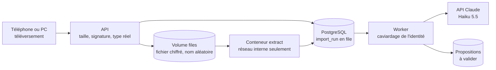

# Phase 1 : profil et imports, plan détaillé

Proposition du 22/11/2026, **en attente de la validation de Mehdi**. Aucune ligne de code de la phase 1 n'est écrite avant cette validation (`CLAUDE.md`, méthode).

## 1. Résumé

- **Le profil devient la source de vérité** (spécification, section 4) : toutes ses rubriques, saisies et corrigées depuis le téléphone, chacune dans sa table avec un `user_id`, protégée par la sécurité au niveau des lignes de PostgreSQL (RLS), comme le plan de la phase 0 l'annonçait.
- **Import du CV (PDF ou DOCX)** : contrôle du fichier, stockage chiffré, extraction du texte dans un conteneur à part sans accès à Internet, structuration par Claude Haiku 5.5 **sans l'identité ni les coordonnées**, puis validation champ par champ.
- **Import de l'archive LinkedIn (ZIP)** : lecture des seuls fichiers CSV utiles, sans IA ; connexions et messages ne sont jamais lus.
- **Mots-clés de recherche** : Claude Sonnet 5.5 propose 25 à 35 mots-clés et une dizaine de prioritaires, en français, néerlandais et anglais, à partir des métiers cibles ; Mehdi les valide un à un.
- **Indicateur de complétude** : ce qui manque, rubrique par rubrique, avec un lien vers la saisie.
- **Garde-fous de l'IA** : un seul client, dans le worker ; chaque appel journalisé avec son coût ; plafonds de dépense dans la configuration ; aucun outil donné au modèle ; sorties validées par schéma.
- **Ajouté** : sauvegardes chiffrées et restauration testée, puisque de vraies données personnelles arrivent sur la machine de la maison.

## 2. Périmètre et critères de fin

**Inclus** (spécification, sections 4 et 14) : rubriques du profil, mots-clés en trois langues, import du CV et de l'archive LinkedIn, complétude.
**Ajouté** : RLS sur les tables du profil, journal et plafonds des appels à l'IA (section 11), sauvegardes chiffrées (section 11, « Données »).
**Exclu** : collecte et sources (phase 2), géographie GeoNames et notation (phase 3), CV maîtres et documents (phase 4), Gmail et envois (phase 5). La ville de base est saisie en texte, avec son code postal ; elle sera reliée aux localités GeoNames en phase 3.

**Critères de fin, tous vérifiables**

1. Chaque rubrique du profil se remplit, se corrige et se vide depuis le téléphone ; chaque modification figure au journal d'audit, sans donnée personnelle.
2. Sur la machine de la maison, **un vrai CV est importé et validé champ par champ** : accepter, corriger ou ignorer chaque proposition.
3. L'archive LinkedIn est importée et validée de la même façon.
4. **Les mots-clés sont validés par Mehdi** : au moins 25, dont une dizaine de prioritaires, répartis entre le français, le néerlandais et l'anglais.
5. L'indicateur de complétude atteint 100 % une fois les rubriques nécessaires remplies, et dit ce qui manque avant.
6. Chaque appel à l'IA figure dans Paramètres > IA avec son modèle, ses jetons et son coût ; au-delà du plafond, l'appel est refusé avant d'être envoyé ; un test prouve qu'aucune donnée d'identité ne part chez Anthropic.
7. Une sauvegarde chiffrée part chaque jour, et une restauration complète réussit sur une base jetable.
8. CI verte, plan de sécurité de la section 6 appliqué et testé, revue de sécurité de la phase faite.

## 3. Modèle de données

Toutes ces tables portent un `user_id`, une politique RLS et des identifiants UUIDv7. Les noms suivent la section 10 de la spécification.

| Table | Contenu | Remarques |
| --- | --- | --- |
| `profile` | une ligne par compte : motivations (texte et étiquettes), ville de base et code postal, rayon (40 km par défaut, dans la configuration), contrats, régime, télétravail, salaire minimum facultatif, disponibilité | critères pratiques et motivations |
| `identity` | nom, e-mail, téléphone, commune, permis, moyen de déplacement | **chiffrée** (AES-256-GCM, clé dérivée dédiée, liée à la ligne), jamais envoyée à l'IA |
| `target_job` | 1 à 3 intitulés visés, dans l'ordre | les CV maîtres viendront en phase 4 |
| `search_keyword` | mot-clé, langue (fr, nl, en), prioritaire ou non, origine (IA, saisie, import), statut (proposé, validé, écarté) | seuls les mots-clés validés serviront à la collecte |
| `sector_preference` | secteur, préféré, accepté ou exclu | |
| `skill` | outil ou langage, niveau (débutant à expert), années de pratique | |
| `language_level` | langue, niveau CECR global, et au besoin compréhension, oral, écrit | français, néerlandais et anglais proposés en premier |
| `experience` | poste, employeur, lieu, début et fin (au mois), poste actuel | |
| `fact` | une réalisation réutilisable, chiffrée si possible, liée ou non à une expérience | la matière unique des futurs CV et lettres |
| `education`, `certification` | diplôme ou certificat, établissement ou organisme, année | |
| `elimination_rule` | type (langue exigée, secteur, horaires, déplacements, autre) et valeur | appliquées au filtre déterministe de la phase 3 |
| `title_filter_rule` | liste (garde, rejet, toujours) et expression | saisie dès maintenant, mesurée sur des offres réelles en phases 2 et 3 |
| `excluded_company` | employeur exclu, dont l'actuel, et la raison | aucune offre proposée, aucun envoi |
| `upload` | type (CV PDF, CV DOCX, archive LinkedIn), taille, empreinte SHA-256, type réel détecté, nom de stockage aléatoire | le fichier, chiffré, dort dans le volume `files` |
| `import_run` | un import : étapes (en file, extraction, structuration, à valider, appliqué, échec), code d'erreur, texte extrait **chiffré** | texte extrait purgé après validation (délai dans la configuration) |
| `import_proposal` | une proposition : rubrique, contenu, décision (en attente, acceptée, corrigée, ignorée), date | chaque décision est journalisée |
| `past_application`, `saved_offer` | candidatures et offres sauvegardées de l'archive LinkedIn : employeur, intitulé, date, lien | gardées pour les phases 3 et 5 (étalon, pas de seconde candidature) |
| `ai_call` | usage (structuration du CV, mots-clés), modèle, jetons d'entrée, de sortie et lus en cache, coût calculé, statut, identifiant de requête | jamais le contenu des prompts |

**RLS** : chaque requête authentifiée de l'API et chaque tâche du worker travaille dans une transaction qui fixe `job4me.user_id` ; les politiques ne montrent que les lignes de ce compte. Un `WHERE user_id = …` oublié ne fuit donc rien. Les tables d'authentification de la phase 0 gardent leur filtre applicatif, car la connexion cherche une session avant de connaître le compte.

## 4. Imports

1. **Téléversement** (`@fastify/multipart`) : un seul fichier, 5 Mo au plus (configuration). Le type est vérifié par la signature du fichier, jamais par son nom : `%PDF-` pour un PDF ; pour un DOCX, une archive ZIP contenant `word/document.xml` et un type de contenu sans macro (les `.docm` et les fichiers contenant `vbaProject.bin` sont refusés) ; pour LinkedIn, une archive ZIP. Les PDF protégés par mot de passe sont refusés avec un message clair.
2. **Stockage** : fichier chiffré dans le volume `files`, sous un nom aléatoire ; jamais servi tel quel par le serveur.
3. **Extraction**, dans un conteneur `extract` (même image, commande dédiée) : réseau interne seulement, donc PostgreSQL et rien d'autre ; système de fichiers en lecture seule, aucune capacité, mémoire, processus et durée limités ; un rôle PostgreSQL `job4me_extractor` restreint aux tables d'import ; une clé dérivée réservée aux fichiers importés. Une faille d'un lecteur de PDF ne donne ainsi ni Internet, ni les secrets TOTP, ni le reste de la base.
   - PDF : pdf.js (`pdfjs-dist`, sans `eval`, polices et scripts désactivés).
   - DOCX : `mammoth` (texte brut).
   - ZIP : `yauzl`, lecture entrée par entrée, plafonds de taille décompressée, de nombre d'entrées et de taux de compression (bombes ZIP).
   - Archive LinkedIn : seuls les fichiers de la liste blanche (profil, postes, formation, compétences, langues, certifications, offres sauvegardées, candidatures) sont ouverts ; les connexions, messages et autres données de tiers ne le sont jamais. Lecture CSV avec `csv-parse`.
4. **Structuration**, dans le worker :
   - **CV** : l'identité et les coordonnées sont repérées localement (adresses e-mail, téléphones, liens, nom et commune déjà connus) et proposées à la rubrique Identité sans passer par l'IA ; le texte est ensuite caviardé, puis envoyé à Claude Haiku 5.5 avec un schéma de sortie.
   - **LinkedIn** : correspondance déterministe des colonnes vers les rubriques, sans IA.
5. **Validation** : un écran présente chaque proposition, rubrique par rubrique, à accepter, corriger ou ignorer. Rien n'entre dans le profil sans décision de Mehdi. Une proposition proche d'une donnée existante est signalée comme doublon possible.

## 5. IA

| Usage | Modèle | Entrée | Sortie | Coût estimé |
| --- | --- | --- | --- | --- |
| Structuration du CV | Claude Haiku 5.5 (`claude-haiku-5-5`) | texte du CV caviardé, environ 2 000 à 6 000 jetons | propositions conformes au schéma du profil | moins d'un centime par CV |
| Proposition des mots-clés | Claude Sonnet 5.5 (`claude-sonnet-5-5`) | métiers cibles, compétences, secteurs, langues | 25 à 35 mots-clés en trois langues, dont une dizaine prioritaires | quelques centimes par proposition |

Prix d'Anthropic au 3/11/2026, par million de jetons : Haiku 5.5, 0,10 $ en entrée et 0,50 $ en sortie ; Sonnet 5.5, 2 $ et 10 $. Ils iront dans la configuration, avec les noms des modèles, jamais dans le code.

- **Un seul client**, le SDK officiel `@anthropic-ai/sdk`, dans le worker seulement. La clé est un fichier secret de la machine de la maison (`secrets/anthropic_api_key`) : jamais en développement, jamais en CI. Sans clé, la saisie manuelle et l'import LinkedIn marchent toujours.
- **Prompts en français, accents compris** (`docs/SOURCES.md` : un prompt en ASCII produit des réponses en ASCII). Les données arrivent entre balises (`<cv>…</cv>`), avec la consigne de les traiter comme des données et jamais comme des instructions.
- **Sorties structurées** (`output_config.format` avec un schéma JSON tiré des schémas Zod), puis validation Zod ; une sortie invalide a droit à un second essai, puis l'import échoue avec un message clair. Un refus du modèle (`stop_reason: "refusal"`) est traité comme un échec explicite ; pour Sonnet 5.5, le repli côté serveur d'Anthropic est activé.
- **Aucun outil** n'est donné au modèle : il ne fait que proposer, Mehdi décide.
- **Plafonds de dépense** dans la configuration, vérifiés avant chaque appel à partir du journal `ai_call` : 2 $ par semaine et 10 $ au total pour la phase (Hypothèse). En plus, un plafond mensuel à régler dans la console d'Anthropic.
- **Cache de prompt** : consignes et schéma, stables, passent en premier. Le gain ne compte que si le préfixe dépasse le minimum du modèle ; il sera mesuré, pas supposé.
- **Tests en CI sans clé** : un transport simulé vérifie le caviardage (aucun champ d'identité dans la requête), la validation des sorties, les refus, le blocage au plafond et l'écriture du journal. Un CV de test piégé (« ignore tes consignes… ») doit donner des propositions conformes au schéma et rien d'autre. Un contrôle réel, facultatif, tourne sur la machine de la maison avec des CV fictifs, pour quelques centimes, avec l'accord de Mehdi.

## 6. Plan de sécurité court

Exigé par `CLAUDE.md` avant toute fonction d'IA ; il complétera le [modèle de menaces](../security/threat-model.md).

| # | Menace | Contrôles | Tests automatisés |
| --- | --- | --- | --- |
| 1 | Fichier piégé (PDF malveillant, DOCX à macro, faux type) | signature vérifiée, liste blanche de types, 5 Mo au plus, extraction isolée sans Internet, ressources limitées | fichiers piégés de test : refusés ou extraits sans effet |
| 2 | Bombe ZIP, archive démesurée | plafonds de taille décompressée, d'entrées et de taux de compression, vérifiés avant extraction | archive de test au taux extrême : refusée |
| 3 | Faille d'un lecteur de document | conteneur `extract` sans Internet, rôle PostgreSQL restreint, clé dérivée dédiée, lecture seule | `pnpm check:compose` étendu au nouveau service ; droits du rôle testés |
| 4 | Identité envoyée à l'IA | rubrique Identité chiffrée et hors prompt ; caviardage local du texte du CV | requête simulée : aucune valeur d'identité, d'e-mail ni de téléphone |
| 5 | Injection de prompt par le contenu importé | balises, consigne explicite, aucun outil, sortie au schéma, validation humaine de chaque proposition | CV piégé : sortie conforme, aucune action |
| 6 | Dérive des coûts | plafonds hebdomadaire et total, vérifiés avant l'appel ; journal de chaque appel | plafond atteint : appel refusé sans requête |
| 7 | Fuite de la clé d'API | fichier secret sur la machine seulement ; masquage de `x-api-key` dans les journaux ; gitleaks | test de masquage des en-têtes |
| 8 | Données d'un autre compte | `user_id` et RLS sur toutes les tables du profil | deux comptes : aucune lecture croisée, même sans filtre dans la requête |
| 9 | Vol de la base, des fichiers ou des sauvegardes | identité et textes extraits chiffrés, fichiers chiffrés, sauvegardes chiffrées pour une clé hors de la machine, disque LUKS | lecture brute : aucun texte de CV ni coordonnée en clair |
| 10 | Données de tiers de l'archive LinkedIn | liste blanche de fichiers : connexions et messages jamais ouverts | archive de test avec ces fichiers : ignorés |
| 11 | Fuite par les journaux | aucun contenu de CV, de prompt ni de réponse dans les journaux | test de masquage |
| 12 | Téléchargement d'un fichier importé | jamais servi depuis le disque ; passage par l'API après contrôle du compte, en pièce jointe, avec `nosniff` | test d'appartenance |

## 7. Écrans

- **Profil** : complétude en tête, puis une carte par rubrique avec son état ; navigation pensée pour le téléphone.
- **Une page par rubrique** : listes avec ajout, modification et suppression ; validations en ligne ; textes dans les fichiers de traduction.
- **Mots-clés** : un onglet par langue, prioritaires en tête, bouton « Proposer avec l'IA », et pour chaque proposition « garder », « modifier » ou « écarter ».
- **Imports** : téléversement d'un CV ou de l'archive, suivi de chaque import, puis l'écran de **validation champ par champ**.
- **Paramètres > IA** : dépense de la semaine et totale, plafonds, derniers appels (sans contenu).

## 8. API

Toutes les routes : session exigée, CSRF, validation Zod en entrée et en sortie, `user_id` et RLS.

- `GET`/`PATCH /api/profile` ; `GET`/`PUT /api/identity` ; une route par rubrique en liste (`/api/profile/experiences`, `facts`, `skills`, `languages`, `education`, `certifications`, `sectors`, `target-jobs`, `eliminations`, `excluded-companies`, `title-filters`), chacune avec `GET`, `POST`, `PATCH /:id` et `DELETE /:id`.
- `GET /api/profile/completeness`.
- `GET`, `POST`, `PATCH /:id`, `DELETE /:id /api/keywords` ; `POST /api/keywords/propose`.
- `POST /api/imports` (téléversement), `GET /api/imports`, `GET /api/imports/:id`, `POST /api/imports/:id/proposals/:proposalId/decision`.
- `GET /api/ai/usage`.

## 9. Sauvegardes (proposition)

- **Chaque nuit** : `pg_dump` de la base et archive du volume `files`, chiffrées avec [`age`](https://github.com/FiloSottile/age) pour une clé publique. La machine ne garde que la clé publique ; la clé privée vit dans le gestionnaire de mots de passe (décision D5). Une sauvegarde volée reste donc illisible.
- **Rétention** : 14 sauvegardes quotidiennes et 8 hebdomadaires (configuration), copiées vers une destination choisie par Mehdi (voir la décision P5).
- **Restauration testée** : `pnpm stack:restore-test` restaure la dernière sauvegarde dans une base jetable et vérifie les migrations et le nombre de lignes ; la CI teste le script sur des données fictives.
- Commandes `pnpm stack:backup` et `pnpm stack:restore-test`, et un minuteur systemd décrit dans le guide d'installation.

## 10. Ordre de réalisation et démonstration

0. **Plan et ADR** : ce plan validé, les ADR de la section 13.
1. **Données du profil** : migrations, RLS, chiffrement de l'identité, API des rubriques, complétude, tests d'appartenance et de RLS.
2. **Écrans du profil** : rubriques, complétude, traductions, accessibilité, tests de bout en bout.
3. **Fichiers et extraction isolée** : téléversement, contrôles, stockage chiffré, conteneur `extract`, PDF, DOCX et ZIP, fichiers piégés en test.
4. **IA** : client, plafonds, journal, caviardage, structuration du CV, proposition des mots-clés, tests au transport simulé.
5. **Validation champ par champ** et import LinkedIn de bout en bout.
6. **Sauvegardes** chiffrées et restauration testée.
7. **Clôture** : revue de sécurité, modèle de menaces complété, démonstration.

Chaque lot est une branche et une pull request ; la règle de fusion de la phase 0 (Claude fusionne après une CI verte) reste à confirmer.
**Démonstration** : sur la machine de la maison, import du vrai CV puis validation champ par champ ; import de l'archive LinkedIn ; proposition et validation des mots-clés ; complétude à 100 % ; Paramètres > IA ; une sauvegarde puis sa restauration ; CI verte.

## 11. Hypothèses de la spécification que je conteste ou précise

- **« Extraction isolée sans réseau »** : le conteneur `extract` n'a pas Internet, mais il joint PostgreSQL pour lire sa file et rendre le texte. Un isolement total (aucun réseau, fichiers déposés dans un dossier partagé) est possible, au prix d'un échange plus fragile. Je propose le réseau interne, avec le rôle et la clé restreints.
- **« Identité jamais envoyée à l'IA »** : le texte d'un CV contient l'identité. Le caviardage local retire ce qui est connu ou reconnaissable (nom, e-mail, téléphone, liens, commune). Il reste un risque : le nom d'un ancien responsable cité en référence. Je propose de retirer aussi la rubrique « Références » avant l'envoi.
- **Pré-filtre de titre** : les listes se saisissent dès la phase 1, mais elles ne se mesurent que sur des offres réelles, donc en phases 2 et 3.
- **Mots-clés par Sonnet 5.5** : la spécification réserve Haiku à l'extraction et Sonnet à la rédaction ; proposer des mots-clés justes en néerlandais demande la qualité de Sonnet, pour quelques centimes par proposition.
- **Sauvegardes dès la phase 1** : la feuille de route ne les place dans aucune phase, mais la section 11 les exige, et c'est en phase 1 que de vraies données arrivent.
- **Données réelles** : ton vrai CV et ton archive ne passent jamais par l'environnement de développement ni par la CI ; tout se teste avec des CV fictifs. Pour fabriquer une archive LinkedIn fictive fidèle, j'aurai besoin de la liste des fichiers et des en-têtes de colonnes de la tienne, sans leur contenu.

## 12. Décisions à prendre

Les valeurs marquées « Hypothèse » s'appliquent tant qu'une décision n'est pas prise.

| # | Décision | Proposition |
| --- | --- | --- |
| P1 | Métiers cibles (1 à 3) et premiers mots-clés | à fournir au début de la phase 1 (spécification, section 16) |
| P2 | Clé d'API Claude | compte sur la console d'Anthropic, clé avec plafond mensuel, gardée sur la machine de la maison seulement |
| P3 | Envoi du texte du CV, sans l'identité, à l'API d'Anthropic | oui, après lecture de ses conditions de conservation des données (section 12) ; sinon, saisie manuelle et import LinkedIn seulement |
| P4 | Plafonds de dépense IA de la phase | 2 $ par semaine et 10 $ au total (Hypothèse) |
| P5 | Destination des sauvegardes | disque USB, NAS ou dossier synchronisé dans le cloud ; chiffrement avec `age` |
| P6 | Modèle des mots-clés | Sonnet 5.5 (recommandé) ou Haiku 5.5 |
| P7 | Archive LinkedIn | la demander dès maintenant dans les paramètres LinkedIn : l'archive complète peut prendre jusqu'à 24 heures |
| P8 | Fusion des pull requests | Claude fusionne après une CI verte, comme en phase 0, ou Mehdi relit chaque lot |

Rappel de la phase 0 : le dépôt GitHub privé reste à créer (décision D1) pour que la CI tourne.

## 13. ADR à rédiger au lot 0

- **0009** IA : modèles, données envoyées, caviardage, plafonds et journal.
- **0010** Fichiers importés : contrôles, stockage chiffré, extraction isolée.
- **0011** RLS PostgreSQL sur les données du profil.
- **0012** Sauvegardes chiffrées et restauration testée.

## Sources

- Spécification : sections 4 (profil et imports), 10 (architecture), 11 (sécurité), 12 (RGPD) et 14 (feuille de route).
- `docs/SOURCES.md`, section 1.3 : mots-clés en français, néerlandais et anglais, liste complète et prioritaires.
- Référence de l'API Claude (cache du 3/11/2026) : identifiants et prix de Claude Haiku 5.5 et Claude Sonnet 5.5, sorties structurées, cache de prompt.
